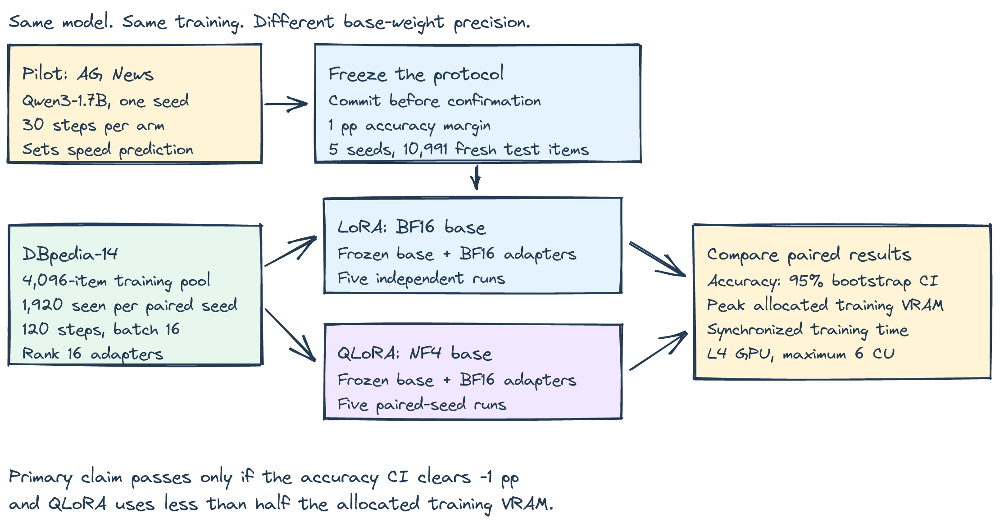
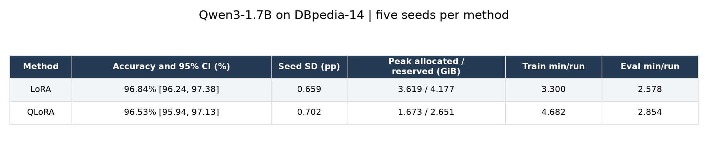
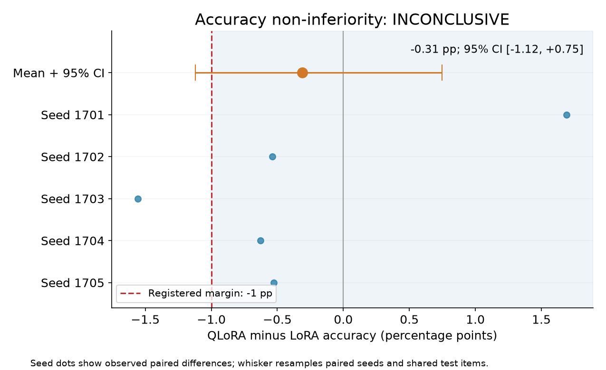
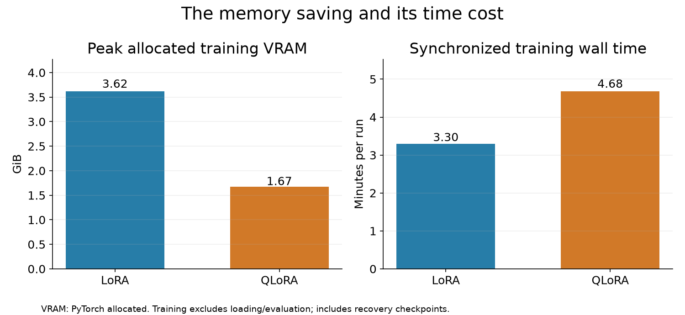

# QLoRA’s one-point accuracy margin remains unresolved on DBpedia

*A five-seed Qwen3-1.7B comparison, with 10,991 shared test examples and the decision rules committed first.*

The [QLoRA paper](https://arxiv.org/abs/2305.14314) makes a concrete promise: lower memory use while “preserving full 16-bit finetuning task performance.” If you maintain a fine-tuning pipeline, that promise affects a concrete decision: can you fit the job on the GPU you already have without giving away useful accuracy?

The phrase sounds simple. Testing it requires defining both “preserving” and “memory.” Two rounded accuracy numbers can hide an unacceptable loss. A smaller model footprint does not automatically mean the entire training process uses less than half the memory.

My headline result is **-0.31 percentage points**: QLoRA accuracy minus LoRA accuracy, with a 95% confidence interval of **[-1.12, +0.75] points**. The combined verdict under the rules I committed before confirmation is **INCONCLUSIVE**.

The accuracy claim remains inconclusive: the confidence interval crosses the registered minus-one-point margin. The strict memory claim passed: the entire seed-bootstrap interval was below half.

## What I tested

I used [Qwen/Qwen3-1.7B](https://huggingface.co/Qwen/Qwen3-1.7B) on NVIDIA L4 GPUs in Colab. The task was classifying short article excerpts into the fourteen categories in the public [DBpedia-14 dataset](https://huggingface.co/datasets/fancyzhx/dbpedia_14). The model returned a score for each permitted class code, A through N. It did not generate explanations or reasoning traces.

Both methods trained rank-16 adapters on the same attention and MLP projections. LoRA kept the frozen base weights in BF16. QLoRA stored eligible frozen linear weights in NF4 with double quantization. Both computed in BF16 and used BF16 adapters with FP32 optimizer master weights and states.

There were five paired seeds per method. Within each pair, adapter initialization and the training-example order matched. Each fit ran 120 optimizer steps at effective batch size 16, with learning rate 0.0002 and no method-specific tuning. That means 1,920 training examples per fit, drawn without replacement from a fixed 4,096-item pool.

Every fit saw the same 10,991 held-out test items. Repeating those items across seeds measures training variation; it does not turn them into 54,955 independent articles. The confidence intervals account for both seeds and shared test items.

The diagram shows the separation between the pilot and confirmation. The two training branches differ in base-weight precision, while the adapter recipe and test set stay paired.

## Why I used a pilot, then changed datasets

Before confirmation, I ran one paired pilot on AG News: thirty steps, 480 training exposures and 256 test items. The pilot served three purposes: checking the implementation, estimating disagreement for sizing, and predicting training time.

The models disagreed on 9.77% of pilot predictions. I used the upper Wilson confidence bound on that rate, 14.02%, to size an approximate 0.7-point item-level confidence half-width. That calculation selected 10,991 confirmation items. It was an explicit sizing calculation, not a round sample chosen because it looked sufficient.

There is a catch: pilot disagreement on AG News need not transfer to DBpedia. Neither does one pilot seed estimate the tails of seed variation. The sizing is a reasoned starting point, not a guarantee that the test will pass.

The final sample size and speed prediction were committed before I authorized the confirmation job. Pilot outcomes are excluded from the reported confirmation intervals.

## The accuracy result

LoRA averaged **96.84%** accuracy. QLoRA averaged **96.53%**. The paired seed differences ranged from -1.56 to +1.69 points.

The table puts accuracy, peak allocated training memory and training time side by side. Its accuracy intervals include both test-item and training-seed uncertainty.

I resampled paired seeds and common test items together for 10,000 bootstrap draws, keeping the comparison paired throughout.

The orange point is the mean difference; its whisker is the 95% interval. Blue dots show each paired seed. The dashed line is the registered minus-one-percentage-point margin, so the location of the whole interval determines the non-inferiority decision.

I chose that margin because a one-point average loss was the practical tolerance specified for this experiment. It is not a measured claim that every user ignores a one-point error increase. An engineer handling rare, expensive mistakes may reasonably demand a tighter margin.

Non-inferiority also does not establish identical models. Two classifiers can have similar average accuracy while making different mistakes. This experiment tests average accuracy under a defined recipe, not interchangeable behavior on every category or example.

## The memory saving had a time price

LoRA peaked at **3.62 GiB** of allocated training memory. QLoRA peaked at **1.67 GiB**, a ratio of **0.462**. These include resident model weights and training allocations, measured after resetting PyTorch's peak counter immediately before training. The frozen embeddings and output head stayed in BF16 in both arms. This memory result belongs to that precision policy and the shared FP32 optimizer recipe. The [PEFT 0.17.1 preparation helper](https://github.com/huggingface/peft/blob/v0.17.1/src/peft/utils/other.py#L102-L144) casts non-quantized BF16 parameters to FP32. Our registered worker freezes the base and enables checkpointing explicitly, retaining BF16 for those parameters. A copy of this experiment that uses the helper unchanged is a different memory recipe.

The left panel compares peak allocated VRAM; the right compares synchronized training time. QLoRA took **4.68 minutes** per fit against **3.30 minutes** for LoRA, or **1.42 times as long**.

Allocated memory is the registered primary metric, but it is not the whole capacity story. Peak reserved memory averaged 4.18 GiB for LoRA and 2.65 GiB for QLoRA. That is 63.5% of LoRA's reservation, so reserved memory was not halved. The under-half finding applies to allocated memory. The allocator can reserve more than live tensors need. Driver-level process memory adds another view, and the saved logs include nvidia-smi snapshots.

Training time excludes model loading, tokenization and evaluation. It includes the checkpoint writes used for recovery. Both methods followed the same checkpoint policy. This measures the training loop we actually ran, not an idealized kernel benchmark.

A four-bit checkpoint does not promise a four-times-faster training loop. Storage precision and computation precision differ here: both arms use BF16 computation, and NF4 relies on the quantization implementation. I did not profile kernels, so this experiment measures the time penalty without assigning it to a single cause.

The pilot predicted a **1.392×** slowdown. Before confirmation I required the timing interval to stay above one and within 20% of that prediction. That speed prediction passed its registered tolerance.

## What surprised me, and what I got wrong

My main prediction remains unresolved. I expected the accuracy interval to clear minus one point, and it did not. Having 10,991 articles does not guarantee a decisive answer when training seeds also contribute uncertainty. The pilot-based sizing addressed test-item uncertainty; one pilot seed could not settle the seed component.

Seed 1701 favored QLoRA by 1.69 points; seed 1703 favored LoRA by 1.56. The mean hides that swing. More test articles alone would not remove training variation.

The old run tied on training speed. The new pilot did not: QLoRA took 39% longer. That changed the operational expectation before confirmation, and the pilot-derived speed prediction was then committed.

The pilot gave QLoRA higher accuracy than LoRA, 87.50% versus 85.16%. It would have been tempting to predict an accuracy improvement. I did not: 256 examples and one seed are too little evidence for that stronger claim, particularly when confirmation changes tasks.

One correction to the follow-up premise: #101's saved writeup used Qwen3-4B and already supported its QLoRA accuracy comparison. Its overall inconclusive verdict came from DoRA. This is a fresh-model replication with a stricter memory target.

The first Colab VM was pruned after five saved confirmation fits. A replacement L4 ran only the missing fits under the unchanged protocol. Seed 1703 crosses hosts, which limits the paired timing comparison.

The registered outcomes remain H1 **INCONCLUSIVE**, H2 **PROVEN**, and H3 **PROVEN**. Accuracy and memory determine the combined verdict; speed is diagnostic.

## What I would do in production

1. **Set an error budget before switching.** Choose a margin tied to the cost of mistakes, then compare paired predictions on representative held-out examples. Average accuracy may need a companion metric for critical classes.
2. **Measure the whole workload's memory.** Keep allocated, reserved and process memory separate. Repeat at production sequence lengths and batch sizes before selecting a smaller GPU.
3. **Price the time tradeoff.** Use measured training and evaluation times, including loading if jobs are short. A configuration that fits can be valuable even when each step takes longer.
4. **Preserve a reproducible baseline.** Pin model revisions and package versions, save split indices and predictions, and keep the BF16 LoRA recipe available. Change one consequential setting at a time.

## Where this result stops

The largest task limitation is the prompt budget. At 128 tokens, the category legend and answer suffix consume 78 tokens. Only fifty tokens remain for article content. This is short-excerpt classification. The loop trains only the final class-answer position; a full-token language-modeling loss would have a different memory and compute budget.

There is also only one model size, one GPU type and five seeds. Five is better than one, but it still gives a coarse view of training variability. The fixed short training schedule does not establish convergence or the best achievable accuracy for either method. Public benchmark exposure during pretraining is possible and was not measured.

The comparison does not cover long-context generation, tool use, instruction following or serving throughput. The memory ratio depends on what remains unquantized and on the optimizer and activation budget. The runtime ratio depends on this L4 and these library implementations. This also uses a shared AdamW recipe, rather than reproducing every detail of the original QLoRA paper.

Timing: estimated 150 minutes; actual 341.0 minutes including slot waits. The two L4 VM lifetimes used an estimated 3.091 CU from their combined elapsed lifetimes at the observed 1.54 CU/hour rate, below the six-unit cap. Shared account balance changes cannot isolate this experiment's bill.

Measure the memory saving, price the extra training time, and require your own error budget to pass.

Code: <repo link placeholder>
